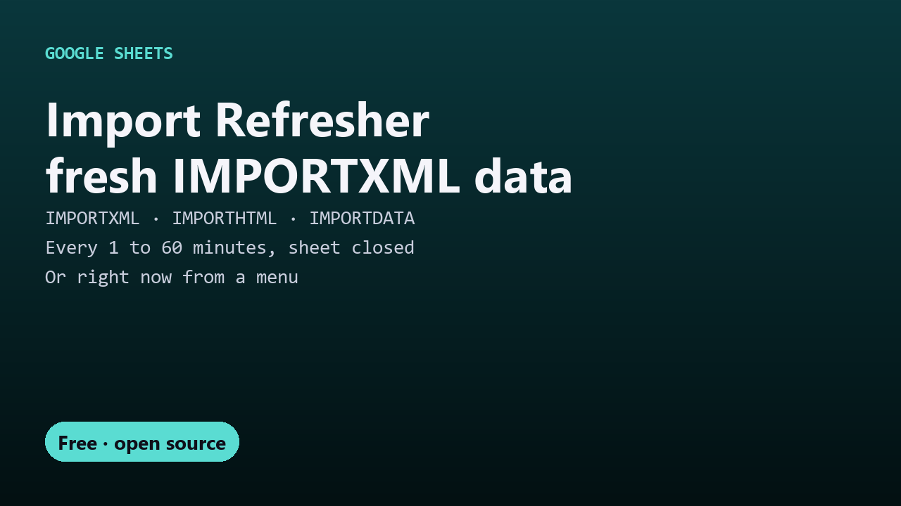

# Free Import Refresher for Google Sheets

Refresh IMPORTXML, IMPORTHTML, IMPORTDATA, IMPORTFEED and IMPORTRANGE in Google Sheets every 1 to 60 minutes, even with the sheet closed. One free Apps Script file.

## Guides

- [How to refresh IMPORTXML in Google Sheets automatically](refresh-importxml-google-sheets.html)

## Get it

The script and full instructions are on GitHub: [DecodedXR/sheets-import-refresher](https://github.com/DecodedXR/sheets-import-refresher). It's MIT licensed and free.
